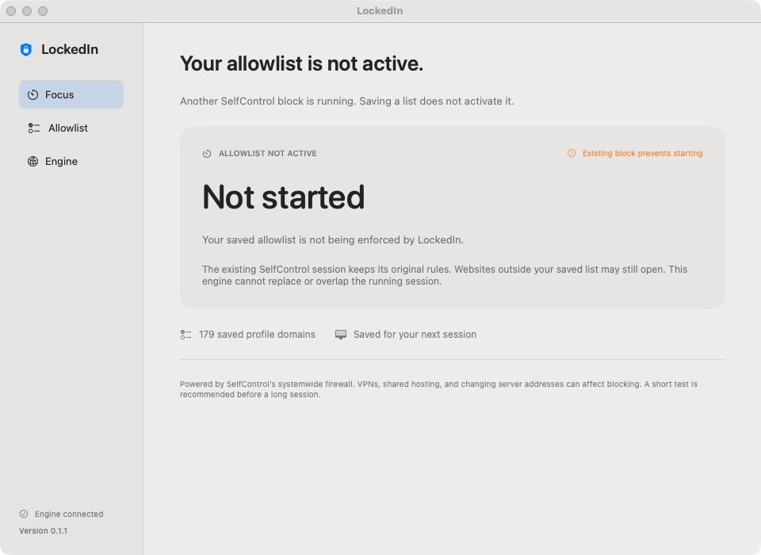

# LockedIn

A Mac app that puts an allowlist at the center of a timed focus session. Choose the websites you need, set a duration, and let SelfControl's systemwide firewall engine handle the block.

**Current release: 0.1.1 preview. macOS 13 or newer, Apple Silicon and Intel.**



## What it does

- An allowlist-first interface with saved profiles and JSON import/export.
- Session presets from 5 to 120 minutes, including a 60-minute default.
- Systemwide network blocking through the bundled, unmodified SelfControl 4.0.2 engine.
- Blocks continue after LockedIn closes or the Mac restarts. An active block cannot be cancelled early.
- Detects an existing SelfControl session and prevents overlapping blocks.
- Explicitly shows that the saved allowlist is inactive when another SelfControl session prevents starting it. Saving or importing a profile does not activate blocking.
- A menu-bar shortcut and a session countdown.
- No Chrome extension, cloud account, or history upload is required.

## Important limits

The SelfControl engine works with resolved server IP addresses. It does **not** provide a strict hostname content filter. Sites sharing a server may share access. When a Google service is allowed, the upstream engine allows Google IP ranges, which may also permit other Google services such as YouTube. VPNs and proxies can affect enforcement. Previously loaded pages and offline content are not erased.

**“Allow every .edu site” is not supported by this engine.** Add the school hostnames and required sign-in services explicitly. The app rejects profiles requesting the unsupported wildcard before a block can start.

The app can confirm that the upstream engine reports a running block. That status is not proof that every possible destination is filtered correctly. Start with a short test and check your required homework, document, authentication, and AI workflows.

This preview has an ad-hoc signature for its new frontend and is not notarized. The bundled upstream engine retains its original developer signature. No live network block is started by the build or test commands.

## Use

1. [Download the 0.1.1 preview](https://github.com/Yongyuan-Hu/locked-in/releases/tag/v0.1.1), or build the app below.
2. Open `LockedIn.app`.
3. Open **Allowlist**, enter one hostname per line, and save. Include the login, document, and supporting services your workflow needs.
4. Check **Engine**. An existing SelfControl block must finish before another can begin.
5. Choose a duration, click **Start session**, and review the confirmation. Complete the normal macOS authorization prompt if requested by the upstream engine.

There is no early-stop button. Wait for the timer to finish. Do not remove the engine while a block is running; refer to [SelfControl's support documentation](https://github.com/SelfControlApp/selfcontrol/wiki/FAQ) for engine issues.

## Build

Install the macOS command-line developer tools, then run:

```sh
bash scripts/check.sh
bash scripts/build.sh
```

The build produces `dist/LockedIn.app`, a universal Mac release ZIP, and SHA-256 checksums. It downloads a pinned engine archive from the official SelfControl distribution site, checks its SHA-256 and developer signature, builds the frontend for both Mac architectures, and preserves the engine's signature.

The frontend has no third-party package dependencies. Full XCTest uses Xcode; the standalone `CoreChecks` executable also runs with just the command-line tools. CI builds and tests on a Mac runner. Rebuilding the upstream engine itself requires Xcode and the dependencies described in `Vendor/SelfControl/README.md`.

## How it works

The SwiftUI app validates and saves an allowlist locally. On a confirmed start, it creates the upstream `.selfcontrol` property list with `BlockAsWhitelist = true` and invokes the bundled `selfcontrol-cli` with literal process arguments. The upstream engine performs authorization, firewall setup, persistence, and expiry cleanup. LockedIn does not install a new privileged helper implementation or modify the upstream binary.

Engine status is checked independently of the displayed countdown. Unknown or failed status checks disable starting a new block. The display timer uses system uptime during the same boot; the engine's own timer remains authoritative for enforcement.

The shared SelfControl daemon means a session started in either application is visible to the other. LockedIn does not change an existing session.

If another SelfControl session is already running, LockedIn cannot activate its saved allowlist until that session finishes. The existing session keeps its original mode and rules, so websites outside the saved allowlist may still open. An engine connection or a saved domain count is not confirmation that the allowlist is active.

## Privacy

Profiles and display-session metadata live in `~/Library/Application Support/LockedIn/`. Profiles are user-specific files with restricted permissions. The public starter list is generic; no personal browsing history, private school profile, tokens, or account identifiers are included in this repository.

LockedIn adds no analytics. Its start command sets the upstream engine's optional session error reporting to off. SelfControl's independent privacy behavior and settings are described in its [privacy policy](https://selfcontrolapp.com/privacy.html).

## License and credits

GPL-3.0-or-later. See [LICENSE](LICENSE) and [THIRD_PARTY_NOTICES.md](THIRD_PARTY_NOTICES.md). SelfControl was created by Charlie Stigler, Steve Lambert, and contributors. The corresponding engine source is vendored in this repository and included inside the built app.
